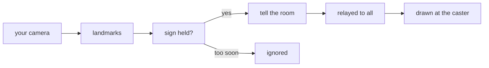

## Context

ROAM walks a Gaussian-splat scan of a real room in the browser (`app/src/apps/roam/`, three.js r180 with `@sparkjsdev/spark`). A link puts up to six people in the same scan, each drawn as a camera-facing plane carrying their video and heard through a `PannerNode` placed where they stand. Nothing in the app reads a person's body: movement is W/A/S/D, and the only input a room relays is a position.

What exists and is reused rather than rebuilt:

- `app/src/apps/roam/live-room.ts` — joins the room and already calls `getUserMedia({ video: { facingMode: 'user' }, audio: true })` for the figure, so the stream hands are read from is already open. It also owns the `AudioContext` and the first-press `unlock` a browser demands before sound.
- `app/src/apps/roam/messages.ts` and `app/worker/apps/roam/wire.ts` — the one checked message shape, page side and room side. `relay()` already fans a position out to everyone else; a cast goes down the same path.
- `app/src/apps/roam/presence.ts` — the pure reducer holding who is in the room and where, including `Peer.motion`, from which the caster's current position is read.
- `app/src/apps/roam/audio.ts` — `gainFor` and `listenerFrom`, the tested loudness curve and listener orientation the voices use.
- `app/src/apps/roam/RoomViewer.tsx` — the renderer, the frame loop, and the `latest` ref pattern that lets fast-changing room state reach the loop without rebuilding the renderer.
- [AR in the browser](../../../wiki/development/ar-in-the-browser.md) — measured: `getUserMedia({ video })` is refused outright during an `immersive-ar` session, because ARCore holds the camera. So a phone in the real room cannot cast.

Two constraints from the repo rather than the idea. Pull request #10 (`roam-body`) rewrites `stage.ts`, `placement.ts` and parts of `RoomViewer.tsx`; this change was asked to avoid a conflict, so it keeps out of those files as far as it can. And every line of ROAM code is tested at 100% of lines, branches, functions and statements ([the mini-app rules](../../../wiki/stack/mini-apps.md#the-rules)), over code whose real runtime is a GPU and a camera — so the split between pure rules and thin shells is not a style preference here, it is what makes the change buildable.

## Goals / Non-Goals

**Goals:**

- Hands read from the person's own camera in the room, off until asked for.
- A held sign turned into one of a named list of techniques, with a hold before it counts and a wait between casts.
- The technique drawn in the scan around the caster's position, for everyone in the room, and heard from there.
- Sound made on the spot, placed in space, with nothing taken from the anime.
- No conflict with the figures work in flight.

**Non-Goals:**

- Casting from a phone in the real room. The AR session holds the camera; a phone watches.
- A technique that touches anybody or anything — no damage, no score, no effect on where people stand or what they can press.
- Aiming. A technique is placed at the caster, not where they point, because no direction is relayed yet.
- Reading anybody's hands but your own. Peers' video arrives as a texture; running three more landmarkers over it would cost the frame budget and buy a demo nothing.
- Saving a cast. It exists while it is on screen.

## Decisions

**Hands come from the stream the room already opened.** `useLiveRoom` holds the local `MediaStream` inside its effect; it gains an exposed handle so the hand reader can take the video track. The alternative — a second `getUserMedia` for the hand reader — asks a second permission for a camera the page already has open, and on some machines a second open of the same device fails outright. The cost is that `live-room.ts` is touched, which `roam-body` does not touch, so this stays conflict-free.

**MediaPipe's `HandLandmarker`, vendored, not a CDN.** `@mediapipe/tasks-vision` 1.1.1 (published 2026-10-14) gives 21 landmarks per hand in the browser with GPU inference. Its `wasm/` files and `hand_landmarker.task` are copied into `app/public/apps/roam/` and loaded from the app's own origin, beside `room.spz`, because a hackathon demo on conference wifi should not depend on `storage.googleapis.com`. The alternatives: TensorFlow.js handpose (bigger, slower, less maintained) and writing a classifier over raw pixels (not a real option — the signs here differ by which fingers touch, which needs landmarks).

**The reader is a seam; the rules are pure.** `hands.ts` is the only file that imports MediaPipe: it takes a video element and a callback and reports landmark frames, with the landmarker injectable so a test drives it with recorded frames and no WebAssembly. Everything judged lives in pure modules — `signs.ts` (landmarks → a sign, with hold and cooldown), `techniques.ts` (the list, and what a technique looks like at a moment of its life). This is the split `wire.ts` has from `room.ts`, and the only way the 100% bar is met over camera and GPU code.

**A sign is geometry over normalized landmarks, not a trained classifier.** Each sign is a predicate over distances between named landmarks, scaled by the hand's own size so distance from the camera does not matter:

| Sign | Test |
|---|---|
| Domain | Thumb tip and middle fingertip within a fraction of hand size; index and little finger extended; one hand |
| Hollow purple | Two hands; index fingers extended on both; the two index tips within a fraction of hand size of each other |
| Blue | One hand; all five fingers extended and spread; the hand's bounding box growing across recent frames |

A predicate is a few lines and a table of cases; a trained classifier needs data nobody has and cannot be explained when it misfires. The readout in the bar prints which predicate currently holds, which is also how a person works out why nothing fired.

**A sign fires only after it is held, and then not again for a while.** `signs.ts` is a small state machine: a sign must hold for a number of consecutive frames before it counts, and after a cast nothing fires until that technique's life plus a cooldown has passed. Without the hold, every wave of a hand crosses one of the predicates; without the cooldown, holding the sign fires continuously.

**A cast names a technique and nothing else.** The page sends `{ type: 'cast', technique }`; the room answers everyone else with `{ type: 'cast', id, technique }` and the position comes from where the room already knows that person is. A page that could name its own position could open a domain inside somebody's face, and the position is relayed ten times a second anyway. `wire.ts` refuses an unknown name and refuses a cast that arrives sooner than the cooldown allows, keeping the per-connection timestamp beside the member — the room's existing habit of refusing what it cannot trust, extended by one case.

**Drawing lives in its own three.js group, not in `stage.ts`.** `casting-stage.ts` owns a group added to the world: a dome mesh, two gathering points, an orb, and a flash, each hidden until a technique is live, each updated from `techniques.ts`'s timeline given the technique, its age, and the caster's position. `RoomViewer.tsx` gains one prop — the live casts — and three lines in the frame loop. `stage.ts` keeps the figures and the markers and is not edited, which is both the conflict answer and the cleaner split: the figures are the room's people, a technique is an event over the top of them.

**The sound is synthesized and panned.** `technique-sound.ts` builds each technique's sound from oscillators and a noise buffer through the room's existing `AudioContext` — a low swell into a crack for the domain, a hum rising into a burst for the orb, a reverse swell for the blue — then puts it through a `PannerNode` at the caster's position, reusing `gainFor` and the same listener update the voices use. No audio file ships, so nothing is downloaded and nothing is lifted from the anime.

### The pieces

| File | Holds |
|---|---|
| `src/apps/roam/hands.ts` | The landmarker over the room's own video track; the only MediaPipe import |
| `src/apps/roam/signs.ts` | Landmarks → a named sign; the hold and cooldown state machine |
| `src/apps/roam/techniques.ts` | The list of techniques, their lives, and what each looks like at an age |
| `src/apps/roam/casting.ts` | The hook: reader on and off, a fired sign told to the room, the live casts on screen |
| `src/apps/roam/casting-stage.ts` | The three.js group that draws them |
| `src/apps/roam/technique-sound.ts` | Each technique's sound, placed where the caster stands |
| `worker/apps/roam/wire.ts` | One incoming and one outgoing message, validated and rate-limited |
| `src/apps/roam/messages.ts`, `presence.ts` | The same message on the page's side, and the live casts in the room's picture |
| `src/apps/roam/RoomViewer.tsx`, `Scan.tsx`, `live-room.ts` | One prop, the bar's controls, the exposed local stream |

### The flow

## UX

### Use-case brief

**Who, and the job.** Somebody in a live ROAM room, at a laptop, showing the room off — at a hackathon demo, in the common case, with other people watching the same scan. The job is to do something visible with their hands and have everyone else see it happen where they are standing.

**What done looks like.** They made a sign, the room answered within a moment, and somebody else in the room reacted to it. If it did not fire, the bar told them what sign it could see, so the next attempt was better.

**Context of use.** At a desk, on a laptop, in a browser tab already in a room, hands up in front of a webcam. The phone layout is not designed for: a phone in the real room is in an AR session and cannot have the camera, and a phone watching the scan can watch a cast but not make one.

**Common case vs edge case.** The common case is hands on, one sign, a technique. The edge cases — a browser with no camera permission, a machine too slow to run the landmarker, a sign that never quite holds — each get a plain line in the bar rather than silence.

**Frequency assumptions, stated to be challenged.** Somebody turns hands on once per demo and casts a handful of times in a few minutes, then leaves it on. So the control is one toggle in the bar, not a panel, and the readout has to be glanceable while their hands are up and their eyes are on the scan.

**The screen this mirrors.** The bar in `Scan.tsx`, which already carries the room's badges — the splat count, `sound off`, the note count — and its buttons on the right. Hands on joins them; nothing is moved.

### Flow

Open a room's link → the scan loads → press *Hands on* → the tag appears and the readout starts naming what it sees → make the sign → the technique fires for everyone → it is over in a few seconds and the next one can be made. *Hands off* ends it; closing the tab ends it.

Edge branches: camera refused → the bar says the room needs the camera, as it does today for the figure. The landmarker will not start → the bar says hands cannot be read in this browser and the toggle goes back to off. A sign is seen but never held → the readout names it, which is the whole hint.

### Hierarchy

The scan's primary action stays *Full screen*. *Hands on* is an outline button beside the camera presets, the live tag and the readout are badges, and the technique itself is the loudest thing on the page while it runs — deliberately, since it is the point. No panel, no dialog, nothing that covers the scan.

### Review

[review.html](review.html). The bar with hands on and the readout is sketched in the first What Changes item; the domain and hollow purple are drawn in the second and third; the sign-to-technique list is the table in the fourth; the relay is the flow in the fifth.

### Components

Existing parts only, from `app/src/components/ui/`: `Button` (outline and ghost) and `Badge` (secondary and outline), exactly the set `Scan.tsx`'s bar already uses. Nothing new is added, no stylesheet comes with the app, and the effects are drawn by three.js inside the existing canvas rather than by DOM over it.

## Risks / Trade-offs

- **The landmarker costs frames next to 600,000 splats** → it runs on the video element rather than the render loop, at a capped rate, and the first task measures the frame cost on the preview before anything else is built on it. If it is too heavy, the rate drops before the feature does.
- **An 8 MB model on the first cast** → it loads when hands are turned on, not when the room opens, so a room nobody casts in downloads nothing. The toggle shows a loading state while it arrives.
- **A sign fires when nobody meant it** → the hold, the cooldown, and the readout that names what is seen. Hands off is the starting state, so a room nobody asked is never watched.
- **A page spams casts** → the room refuses one that arrives sooner than the cooldown and relays nothing, the same way it refuses a position outside the scan.
- **Light, skin tone, and a cluttered background change how well hands are read** → the readout is the honest answer: it says what it sees, so a person can move or change the light rather than guess. The predicates are scaled by hand size so distance from the camera does not matter.
- **A flashing, inverting effect is unpleasant for some people** → the inversion is brief and the dome is the main event; if it reads badly on the preview, the flash goes and the dome stays. Hands off removes it entirely, and nobody else can start one in your view without being in your room.
- **It lands on the `roam-notes` branch** → the two are reviewed together, which was the choice. Keeping to new files and leaving `stage.ts` alone means the merge with pull request #10 is still only `RoomViewer.tsx`.
- **MediaPipe is a new dependency with a vendored binary** → it is pinned, it is the stable release from 2026-10-14, the vendored files are copied by a script in `package.json` rather than by hand, and nothing in the Worker imports it.

## Migration Plan

Additive throughout: new files, one message added to the room's existing relay, one prop on the viewer, two controls in the bar, and no table, route, key or migration. A room with hands off renders exactly as today. Reverting the change leaves nothing behind; an older page in a room with a newer one ignores a `cast` it does not know, because both sides drop a message that does not fit their shape.

## Open Questions

None. The frame cost of running the landmarker beside the splats is an unknown, not an open question: it is the first task, and the rate is the dial that answers it.
