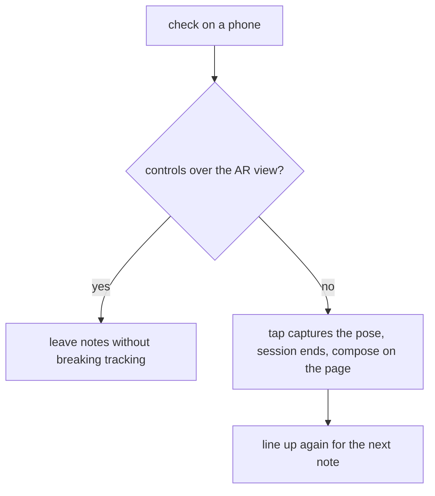

## Context

The ROAM app walks a Gaussian-splat scan of a real home, now two floors deep (`app/public/apps/roam/room.spz`, 613,872 splats, 11.6 MB, with both floor heights in `scene.json`). A link puts up to six people in it live, drawn as camera-facing planes, heard by distance and direction, and an Android phone in the real home drives a figure from its own movement tracking.

Everything in it is momentary. A room is a Durable Object named by a throwaway id; close the tab and the place is empty again. Nothing in the scan can be pressed, and no information survives a session, which is why the app still reads as a video call with better scenery.

What exists and is reused rather than rebuilt:

- `app/src/apps/roam/ar-session.ts` — `startAr` reports the phone's pose per frame from an `immersive-ar` session with a `local-floor` reference space; Android Chrome only ([AR in the browser](../../../wiki/development/ar-in-the-browser.md)).
- `app/src/apps/roam/placement.ts` — `anchorAt(scene, index)` takes a taped spot from one of the scan's 551 source cameras and now carries that spot's floor; `toScanPose` converts metres from the line-up into scan coordinates; `floorHeight(scene, above)` finds the floor under a height.
- `app/src/apps/roam/audio.ts` and `stage.ts` — `gainFor`, `listenerFrom`, and a `PannerNode` chain with a smoothed gain, plus the first-gesture unlock the browser demands.
- `app/src/apps/roam/stage.ts` — `pick` and `pointerAt` raycast a press into an id.
- `app/worker/apps/inbox/` — the worked pattern for rows in the shared `DB` binding: a migration in `schema/migrations/`, bound statements, and the rules in their own file.
- The site is open: `WORKSPACE_LOGIN` is `off` and no Access identifier is set in `app/wrangler.jsonc`, so "anyone with the address" needs no new work.

## Goals / Non-Goals

**Goals:**

- A place that keeps notes for good, found by anyone with its address, with nobody online.
- Notes left from inside the real home, at the spot the phone was standing, on the right floor of two.
- Written, spoken and photographed notes, the spoken one placed in space so it grows and fades as the listener moves.
- Removal by the author's own browser or the place's one keeper.
- Caps that survive an open address.

**Non-Goals:**

- Leaving a note from inside the scan on a laptop. The next change for this capability, and the reason an iPhone can only read.
- Pinning a note to an object's surface. Finding a surface in a cloud of splats is its own work; standing beside a thing reads as pointing at it.
- Hiding a marker behind a wall. There is no depth handling anywhere in the roam code, and a marker reading through a wall is normal for a pin.
- Scanning the home again to show what changed. Planned separately; the pipeline for it already exists in `experiments/room-scan/pipeline/`.
- Moderation, sign-in, accounts, or a note that expires.

## Decisions

**A place is a D1 row set, not a Durable Object.** A room is one object per throwaway id with its state inside it; a place must outlive every session and be read by people who share nothing but an address. Rows in the shared `DB` binding give that for free, follow the documented path for a table ([the data pipeline](../../../wiki/stack/d1-pipeline.md)), and let a later second place be one more value in a column. The alternative — a Durable Object named `home` — would work, but puts the place's data somewhere migrations, the seed file and a staging reset cannot reach, which is exactly where a demo's sample notes need to be.

**One place today, named in a constant, with its id on every row.** The plain address `/apps/roam/` is the place, so the link people already have is the one that holds the notes, and a live room shows them too because `Room.tsx` renders the same `Scan`. A second scan later adds a row value and an address segment, not a schema change.

**Media in D1 beside the row.** R2 needs a payment method this account has not set ([without R2](../../../wiki/development/memory.md#without-r2)). A clip of a few seconds in Opus and a photo shrunk to 1280 px sit in the low hundreds of kilobytes, far below D1's per-value limit of about 2 MB, and the caps below keep them there. A note's bytes are fetched by their own route, not inlined in the list, so walking the home downloads only what somebody opens. The trade: a place full of photos grows the one shared database, which the count cap bounds.

**Multipart upload, bytes read with a cap before anything is stored.** One `POST note` carrying the note's fields and an optional file is simpler than a two-step create-then-upload, which would leave half-made notes behind when a phone loses signal mid-walk. The request is refused on `Content-Length` first and on the bytes actually read second, because a declared length is not evidence.

**Marked spots, chosen from the scan's own cameras.** The phone's tracking drifts with distance and knows nothing of which floor it climbed to; `anchorAt` already turns a camera index into a spot with its floor. A short list of three or four indices, each given a plain name — *front door*, *top of the stairs*, *kitchen corner* — is picked by eye on the preview and taped in the real home. Pressing *Line up again* and choosing one resets the drift and settles the floor. The alternatives: one spot (what a single room could live with, and this home cannot), or dragging yourself onto a map of the scan on the phone (most flexible, most fiddly, and the most code). Image-target tracking is not an option — it needs a Chrome flag ([AR in the browser](../../../wiki/development/ar-in-the-browser.md#lining-a-phone-up-with-a-scan-needs-a-known-spot)).

**The author's secret and the place's keeper key, both held as hashes.** `POST note` returns a one-time secret kept in that browser; `POST place` mints a keeper key the first time and refuses a second claim, exactly as `room.ts`'s `create()` does for a host. Only their SHA-256 digests are stored, compared with the constant-time `sameKey` already in `ids.ts`, so a leaked database row cannot remove anybody's note.

**A spoken note plays on a press, not as you walk past.** Placed in space either way, but an open place where anyone may leave a clip would otherwise play several at once the moment somebody walks through a cluster. The press is also the gesture the browser needs before any sound at all.

**The pure rules live in their own file.** `notes.ts` holds the caps, the validation and the row-to-wire shaping, and the handlers are the shell that talks to D1 — the same split `wire.ts` has from `room.ts`, and what makes [every line tested](../../../wiki/stack/mini-apps.md#the-rules) possible over code whose real runtime is workerd.

### The data

One additive migration, two tables, times in milliseconds since 1970, media as a BLOB:

- `roam_notes`: `place`, `id`, `kind` (`text` / `voice` / `photo`), `x`, `y`, `z`, `yaw`, `author`, `words`, `media`, `media_type`, `secret_hash`, `created_at`, primary key `(place, id)`, indexed by `place`.
- `roam_places`: `place`, `keeper_hash`, `created_at`.

`schema/seed.sql` gains a handful of sample notes in the scan's own coordinates — one of each kind, on both floors — so a preview and a walk start from real rows.

### The routes

Bare handlers in `app/worker/apps/roam/api.ts`, like `POST room` and `GET socket`; no saved key is involved, so none is listed.

| Route | Does |
|---|---|
| `GET notes` | The place's notes without their bytes: kind, position, facing, author, time, whether media exists |
| `GET note-media` | One note's bytes and content type, cached immutably, since an id is random and its bytes never change |
| `POST note` | Leaves a note; answers with its id and the author's one-time secret |
| `DELETE note` | Removes one, given the author's secret or the place's keeper key |
| `POST place` | Mints the keeper key once; a second claim is refused |

### The caps

| | Cap | Why |
|---|---|---|
| Words | 500 characters | A note, not an essay; reads in the panel without scrolling |
| Voice | 15 seconds, 300 KB | Opus at a spoken bitrate; far under D1's per-value limit |
| Photo | 300 KB, shrunk to 1280 px in the browser | Same, and it draws on a marker without a texture upload stall |
| Notes to a place | 200 | Bounds the shared database against an address anyone holds |

### The browser side

- `notes.ts` (browser) — fetching the list, posting a note, the author secrets kept in `localStorage`, and the pose a note is left at.
- `spots.ts` — the marked spots: a name and a camera index each, refused if the index is past the scene's cameras.
- `note-sound.ts` — a fetched clip played through a `PannerNode` at the note's position, reusing `gainFor` and the room's listener update.
- `Leave.tsx` — the phone's screen, at `/apps/roam/leave`, a new arrival kind in `invite.ts`.
- `Notes.tsx` — the panel a pressed marker opens, and the count in the bar.
- `stage.ts` — a marker group beside the figures; `pick` returns `{ kind: 'peer' | 'note', id }` instead of a bare id, so `RoomViewer.tsx` can tell a person from a note.

### The phone flow, and the thing that must be checked first

An `immersive-ar` session takes over the screen. Whether our own buttons are visible and tappable over the camera view depends on WebXR's `dom-overlay` feature, which this app has never used — and which the *existing* Phone screen's Stop button already depends on without anybody having verified it with a human. The same goes for reaching the microphone and a camera frame while ARCore holds the camera.

So the first task is a check on a real Android phone, before any of this is built on it:

The fallback is worse but workable: the pose is captured at the press, so the note still lands in the right place, and the person re-picks a marked spot for the next one. If the microphone or a camera frame cannot be had during a session, a photo falls back to the system camera through a file input and a clip to recording after the session pauses — both after the pose is already taken.

### The scale constant

Every note's position runs through `PHONE_HEIGHT_M = 1.5` in `placement.ts`, a guess tuned by eye. A figure a foot off reads fine; a note a foot from the valve it describes does not. A task paces a measured distance in the real home against the same distance in the scan, sets the constant, and records the measurement in the wiki.

## UX

### Use-case brief

**Who, and the job.** Two people. The one handing over a home — an owner, a landlord, someone moving out — walks their own home with a phone and leaves what the next person will need to know, beside the thing it is about. The one receiving it opens a link on whatever they have, walks the home, and finds out how it works without anybody being available to ask.

**What done looks like.** For the leaver: the thing they were worried about forgetting is recorded at the thing itself, and they can see it listed. For the finder: they pressed a marker and learned something they could not have learned from a photo gallery — where it is, and what to do with it.

**Context of use.** The leaver is **on a phone, standing up, one-handed, holding the phone in front of them in an AR session**, walking around a home. That is the design; the phone layout is drawn first and is the only layout that screen gets. The finder is at a desk or on a sofa, on a laptop in the common case, because that is where the walking controls work; a phone finder can look and press but not yet walk, which this change does not fix.

**Common case vs edge case.** The common case is a written note left while standing still. Spoken and photographed notes share the same flow one step later. The edge cases — drifted tracking, a refused cap, a phone with no AR at all — each get a plain state rather than a dead end.

**Frequency assumptions, stated to be challenged.** A leaver uses this in one or two bursts of ten to twenty notes, once, and rarely returns. A finder opens the place a handful of times. So the leaving screen is tuned for repeating the same action quickly with no reading, and the finding screen for a first-time visitor who needs to be told what the markers are.

### Flow

Leaver: open the link → pick the spot you are standing on → walk → *Leave a note here* → pick Write, Record or Photo → *Leave it* → back to walking, with the count up by one. Nothing is confirmed twice, and the pose is taken at the press, so composing slowly never moves the note.

Finder: open the link → the room loads and the bar says how many notes are here → press a marker → read, look, or play → *Close*, back where you stood.

Edge branches: tracking drifted → *Line up again* → pick a spot → carry on. A cap refused → the panel says which one and keeps what was typed. No AR on this phone → the screen says so and offers the ordinary scan instead.

### Hierarchy

- **The phone, lined up:** one primary action, *Leave a note here*. *Line up again* is a ghost button under it, and the count is a tag, not a heading — the person is standing in a real room looking at a real object, so the screen should be one obvious target.
- **The phone, composing:** one primary action, *Leave it*. The three kinds are a row of choices above it, the chosen one filled; Cancel stays ghost.
- **The scan:** the primary action stays *Full screen*, as today. A note's panel is a card over the view with one primary action — *Play from here* for a clip, nothing for the others, because reading needs no button — and *Remove* kept ghost and only shown to the author or the keeper, so it can never be the loudest thing in a panel somebody is reading.

### Review

[review.html](review.html). The phone's lined-up and composing screens are sketched in the first two What Changes items, the finder's bar and note panel in the third, and the marked spots across two floors in the fourth.

### Components

Existing parts only, from `app/src/components/ui/`: `Card`, `Button` (default, outline, ghost), `Badge`, `Input`, `Label`, `Skeleton`, and `Loading` for the list's wait, with Tailwind for spacing — the same set `Phone.tsx`, `Join.tsx` and `Host.tsx` already use, and `Watch.tsx` is the panel this change's note panel mirrors. `CopyText` carries the phone link. Nothing new is added, and the app brings no stylesheet of its own.

## Risks / Trade-offs

- **Controls may not show over an AR session** → the first task checks it on a real phone and picks the overlay path or the documented fallback before anything is built on it. The same check settles the existing Phone screen's unverified Stop button.
- **Tracking drift puts a note in the wrong place** → the marked spots reset it, and the walk-through check leaves notes at three known things and confirms each lands beside it.
- **The scale constant is a guess** → measured and set in this change, with the measurement written down.
- **An open address means anyone can leave anything** → size and count caps, the keeper's removal, and nothing executable stored; a photo is served with its own content type and no inline rendering of anything else.
- **Media grows the shared database** → the count cap bounds it, and the next change can move bytes to R2 unchanged if a payment method is ever set.
- **A note left on a preview vanishes** → previews write to the staging database, which `/verify` resets before each walk. Demo notes are left on the live app, and the walk-through check says so.
- **Markers read through walls**, like the figures → accepted as a non-goal; a pin reading through a wall is familiar, and depth handling over splats is its own change.
- **An iPhone cannot leave a note at all** → the screen says so plainly and offers the scan, as the camera screen already does.

## Migration Plan

Additive throughout: one migration that only adds tables, one new address, five new routes, and no change to the room, the figures, the voices or walking the scan alone. A home with no notes renders exactly as today, so there is nothing to roll back behind; reverting the change leaves two unused tables.

## Open Questions

None. The AR overlay is an unknown, not an open question: it is the first task, and both outcomes have a planned flow.
